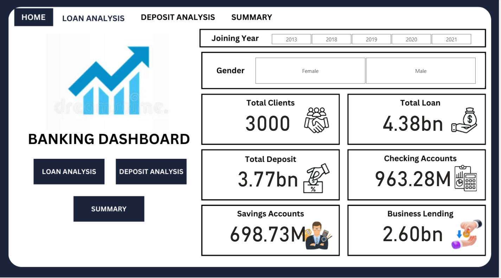
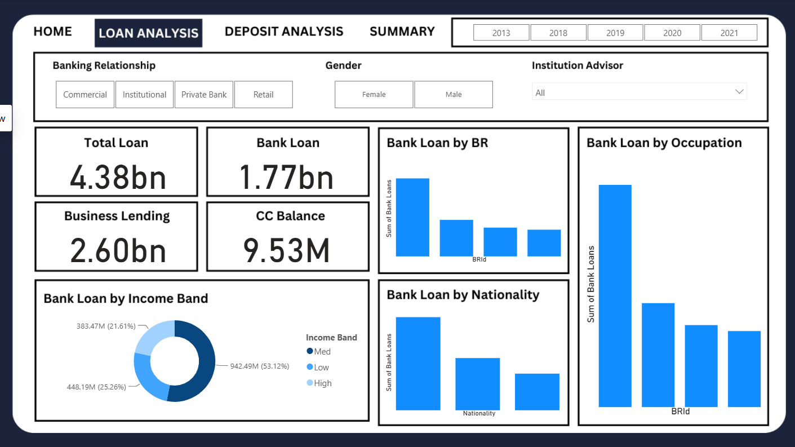
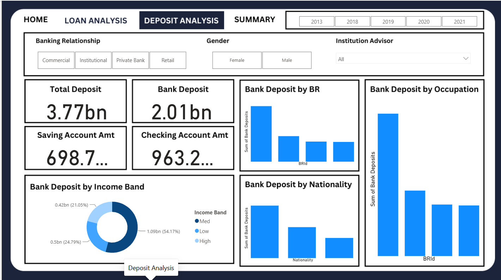

# Banking-business-analysis
Banking Data Analytics using Python, Pandas, SQL and Power BI to analyze customer demographics, income, loans, deposits, and banking business performance.
# Banking Data Analytics & Insights

## Business Overview

This project explores a banking customer dataset and presents insights about customer profiles, income bands, loans, deposits, fees, account balances, nationality, fee structure, loyalty classification, and risk weighting. The workflow combines Python-based exploratory data analysis (EDA) with a Power BI dashboard and a presentation summarising selected KPIs.

## Project Assets

- `banking EDA 1.ipynb` — initial EDA, category distributions, numerical distributions and correlation heatmap.
- `banking EDA2.ipynb` — expanded EDA, income-band creation, descriptive statistics, missing-value check, date conversion, correlation heatmap and pairwise relationship plots.
- `Banking Dashboard (2025) (1).pbix` — Power BI report file.
- `Banking.pptx` — presentation containing the project description and selected dashboard KPIs/observations.

## Dataset Profile  

The notebook reports **3,000 rows × 25 columns**. Fields include client identifier/name, age, location ID, bank-joining date, banking contact, nationality, occupation, fee structure, loyalty classification, estimated income, superannuation savings, number of credit cards, credit-card balance, bank loans, bank deposits, checking accounts, saving accounts, foreign-currency account, business lending, properties owned, risk weighting, and encoded IDs (`BRId`, `GenderId`, `IAId`).

## Workflow

1. **Ingest** the banking CSV into a Pandas DataFrame.
2. **Inspect** shape, schema, data types and descriptive statistics.
3. **Segment income** using `pd.cut`:
   - Low: income up to $100,000
   - Mid: $100,000 to $300,000
   - High: above $300,000
4. **Profile categorical fields** using `value_counts()` for nationality, occupation, fee structure, loyalty classification, properties owned, risk weighting, income band and encoded identifiers.
5. **Check missingness** with `df.isnull().sum()`. The saved output reports zero missing values for all 25 columns after `Income Band` is created.
6. **Convert dates** by parsing `Joined Bank` with format `%d-%m-%Y`.
7. **Explore numeric distributions** using Matplotlib and Seaborn histograms/KDE plots.
8. **Study relationships** using a correlation matrix/heatmap and selected regression plots.
9. **Communicate findings** in Power BI through KPI cards and loan/deposit/customer-category visuals described in the project presentation.

## Python Stack

- Python
- Pandas
- NumPy
- Matplotlib
- Seaborn
- Jupyter Notebook

The provided notebooks do not show inferential hypothesis tests or p-values; their documented statistical work consists of descriptive statistics, frequency distributions, correlation analysis and regression visualisations.

## Key EDA Findings

### Customer profile and categories

- Nationality: European **1,309**, Asian **754**, American **507**, Australian **254**, African **176**.
- Income band: Mid **1,517**, Low **1,027**, High **456**.
- Fee Structure: High **1,476**, Mid **962**, Low **562**.
- Loyalty Classification: Jade **1,331**, Silver **767**, Gold **585**, Platinum **317**.
- Properties Owned: 2 properties **777**, 1 property **776**, 3 properties **742**, 0 properties **705**.
- Risk Weighting: 2 **1,222**, 1 **836**, 3 **460**, 4 **322**, 5 **160**.
- Number of credit cards: 1 **1,922**, 2 **765**, 3 **313**.

### Descriptive statistics

- Mean age: **51.04**; median age: **51**; range: **17–85**.
- Mean estimated income: **171,305.03**; median: **142,313.48**; range: **15,919.48–522,330.26**.
- Mean superannuation savings: **25,531.60**.
- Mean credit-card balance: **3,176.21**.
- Mean bank loans: **591,386.20**.
- Mean bank deposits: **671,560.20**.
- Mean checking-account balance: **321,092.90**.
- Mean saving-account balance: **232,908.40**.
- Mean foreign-currency account balance: **29,883.53**.
- Mean business lending: **866,759.80**.
- Mean properties owned: **1.52**.

Values are taken from `DataFrame.describe()` output and rounded for readability. Currency units are not explicitly established by the notebook itself, so treat these as dataset units unless confirmed in the source data.

### Relationship analysis

The notebook’s written interpretation states:
- Bank Deposits has a high positive relationship with Saving Accounts and describes related relationships with Checking Accounts and Foreign Currency Account.
- Age and Estimated Income have moderate relationships with some accumulation measures such as superannuation, savings and checking balances.
- Properties Owned has weaker correlations with the selected banking metrics.
- Business Lending has a moderate relationship with Bank Loans and is described as relatively less correlated with deposit/property-related measures.

The saved notebook output shows correlation heatmaps and regression plots, but does not expose the exact numeric correlation coefficients as text. This README therefore does not invent coefficients or significance levels.

## Power BI Dashboard Preview

The Power BI dashboard includes Home, Loan Analysis, Deposit Analysis, and Summary navigation. The supplied screenshots show the Home, Loan Analysis, and Deposit Analysis pages.

### Home — Customer and Banking Overview



The Home page presents high-level customer and account KPIs, including total clients, total loans, total deposits, checking accounts, savings accounts, and business lending. It also includes joining-year and gender filters.

### Loan Analysis



The Loan Analysis page explores total loans, bank loans, business lending, and credit-card balance. It includes comparisons by banking relationship, gender, institution advisor, income band, nationality, and occupation, with joining-year filters.

### Deposit Analysis



The Deposit Analysis page compares total deposits and bank deposits, with savings- and checking-account amounts. Visuals break down deposits by banking relationship, income band, nationality, and occupation.

> **Metric note:** Dashboard screenshot values are reported as displayed. The notebook EDA, PowerPoint KPIs, and dashboard may use different filters or measure definitions, so validate totals against the source data before treating them as reconciled.

## Dashboard / Presentation KPIs

The supplied PowerPoint labels these KPIs:
- Total Clients: **188**
- Total Engagement Account: **$18.26K**
- Total CC Account: **$135**
- Total Loan: **$139.9M**
- Total Deposit: **$111.49M**
- Total Fees: **$5.17M**
- Bank Loan: **$55.5M**
- Bank Deposit: **$60.18M**
- Business Lending: **$83.52M**
- Saving Account: **19.85** (slide labels this as “in Millions”)
- Foreign Currency Amount: **$2.71M**

The presentation notes that bank loan is highest for the Mid Income band and lowest for the High Income band. It also states that its “features” are highest for European countries followed by Asian countries, and lowest for Australian followed by African countries; the exact measure represented by “features” is not clearly defined in the extracted slide text.

**Important:** Dashboard KPIs and notebook totals may reflect different filters, aggregations, or measure definitions. The presentation does not provide enough detail to reconcile them, so they are reported separately rather than assumed to match.

## Repository Structure

```text
banking-business-analysis/
├── README.md
├── banking EDA 1.ipynb
├── banking EDA2.ipynb
├── Banking Dashboard (2025) (1).pbix
├── Banking.pptx
└── images/
    ├── banking-home.png
    ├── banking-loan-analysis.png
    └── banking-deposit-analysis.png
```

Upload the three screenshots into the repository's `images/` folder so the embedded previews above display correctly. The full CSV dataset is not bundled by default; only publish data you have permission to share and that fits GitHub's size limits.

## Reproducing the Python EDA

1. Install Python 3 and Jupyter.
2. Install libraries:

```bash
pip install pandas numpy matplotlib seaborn jupyter
```

3. Place the source CSV (the notebooks refer to `Banking.csv`) in your working directory.
4. Update the `pd.read_csv(...)` path for your machine.
5. Open either notebook in Jupyter and run cells in order.

## Power BI Setup

1. Open `Banking Dashboard (2025) (1).pbix` in Power BI Desktop.
2. If prompted, update the data source path to the local banking CSV.
3. Refresh the dataset.
4. Validate measures, filters and visual totals against the source data before publishing or comparing dashboard KPIs to notebook totals.

## Limitations / Next Steps

- The notebooks do not include hypothesis tests or p-values in their saved code/output.
- Exact correlation coefficients are not available as text output in the supplied notebooks; consult the rendered heatmap or recompute from the original CSV before quoting exact values.
- The dashboard PBIX internals were not parsed here; dashboard KPIs above are taken from the supplied PowerPoint text.
- Confirm currency units and the definition of “Total Engagement Account” and “Total CC Account” before using them in external claims.
- Reconcile dashboard counts/totals with the 3,000-row notebook dataset and confirm whether visuals use filters or a separate aggregation.


